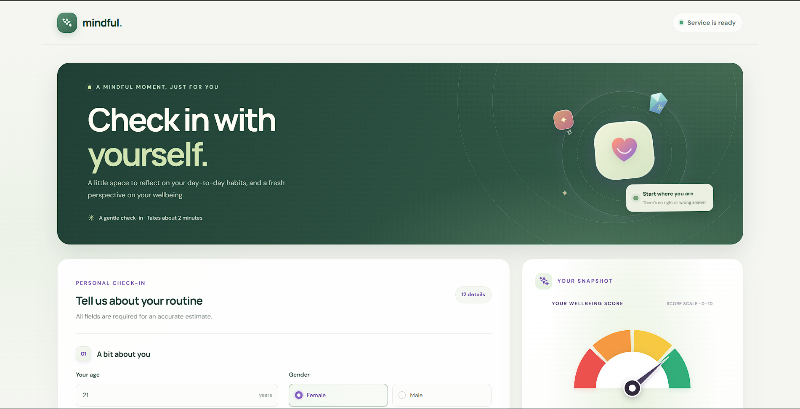
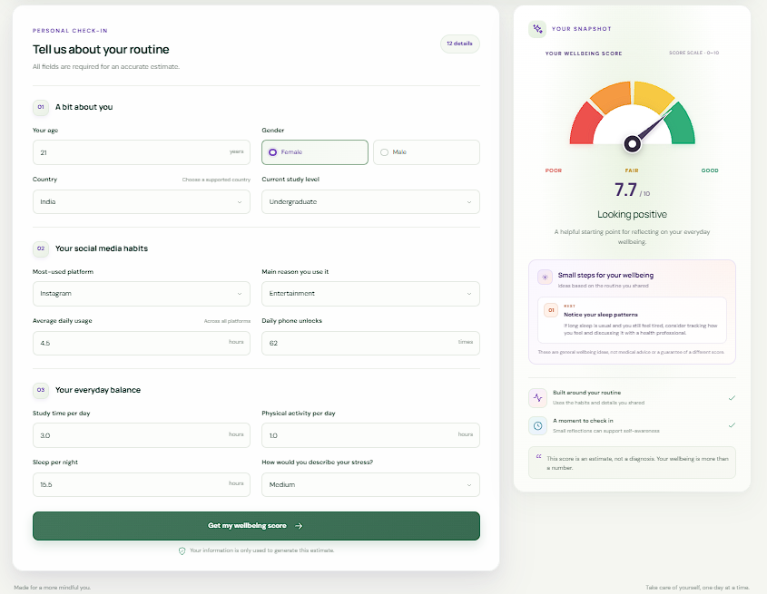

# Mental Health Score Predictor

A full-stack student wellbeing project. Enter details about daily social media
use, study, activity, sleep, and stress to receive a model-generated mental
health score estimate.

**Live website:** [mental-health-ui-v1.onrender.com](https://mental-health-ui-v1.onrender.com/)

## Screenshots





The project contains a FastAPI backend and a React frontend. The frontend
validates and submits the form to the backend, then displays the returned score
on a visual meter alongside general, habit-based wellbeing suggestions.

> **Important:** This score is an estimate from a machine-learning model. It is
> not a diagnosis, medical advice, or a substitute for speaking with a
> qualified health professional.

## Project structure

```text
backend/
  app/
    router/       API routes, including POST /predict
    schemas/      Pydantic request and response models
    util/         Model loading and country grouping
  models/         Trained model file
  main.py         FastAPI application entry point
  pyproject.toml  Python dependencies and version requirement
  uv.lock         Locked Python dependencies

frontend/
  src/
    components/   React page, form, score meter, and suggestions
  package.json    Frontend dependencies and scripts
```

## Requirements

- Python 3.13 or newer
- [uv](https://docs.astral.sh/uv/) for backend dependency management
- Node.js and npm for the frontend

## Run locally

Start each part in its own terminal.

### 1. Start the backend

From the repository root:

```powershell
cd backend
uv sync
uv run uvicorn main:app --reload --host 127.0.0.1 --port 8000
```

The API is available at `http://127.0.0.1:8000`. Open
[`http://127.0.0.1:8000/docs`](http://127.0.0.1:8000/docs) to explore its
interactive API documentation.

### 2. Start the frontend

In another terminal, from the repository root:

```powershell
cd frontend
npm install
npm run dev
```

Open the local URL printed by Vite (typically `http://localhost:5173`). The
frontend checks the backend health endpoint and sends predictions to
`http://127.0.0.1:8000` by default.

To use a different backend URL, create `frontend/.env` and set:

```dotenv
VITE_API_BASE_URL=http://127.0.0.1:8000
```

Restart the Vite development server after changing the environment variable.

## API endpoints

| Method | Path | Description |
| --- | --- | --- |
| `GET` | `/` | Welcome message |
| `GET` | `/health` | Backend health check |
| `POST` | `/predict` | Return a predicted mental health score |

### Prediction request

`POST /predict` accepts JSON with these fields:

```json
{
  "age": 21,
  "gender": "Female",
  "country": "India",
  "academic_level": "Undergraduate",
  "most_used_platform": "Instagram",
  "purpose_of_use": "Entertainment",
  "avg_daily_usage_hours": 4.5,
  "daily_unlocks": 62,
  "study_hours": 3.0,
  "physical_activity_hours": 1.0,
  "sleep_hours_per_night": 7.5,
  "stress_level": "Medium"
}
```

Supported values and limits:

- `age`: integer from 1 to 120
- `gender`: `Male` or `Female`
- `country`: `Other`, `India`, `USA`, `Canada`, `Australia`, `UK`, `Germany`,
  `Mexico`, `Turkey`, or `France` in the frontend. The backend groups
  unrecognized country names as `other`.
- `academic_level`: `Undergraduate`, `Graduate`, or `High School`
- `most_used_platform`: `Facebook`, `LinkedIn`, `Instagram`, `Snapchat`,
  `Twitter`, `YouTube`, `TikTok`, `LINE`, `KakaoTalk`, `VKontakte`, `WhatsApp`,
  or `WeChat`
- `purpose_of_use`: `Networking`, `Education`, `Entertainment`, or `News`
- `avg_daily_usage_hours`: number from 0 to 24
- `daily_unlocks`: non-negative integer
- `study_hours`: number from 0 to 24
- `physical_activity_hours`: number from 0 to 10
- `sleep_hours_per_night`: number from 0 to 24
- `stress_level`: `Low`, `Medium`, `High`, or `Very High`

The response contains `predicted_mental_health_score`, which is a number or a
message if the model cannot return a score. The frontend visualizes numeric
scores on a 0–10 meter.

## Frontend checks

Run these commands from `frontend/`:

```powershell
npm run lint
npm run build
```
